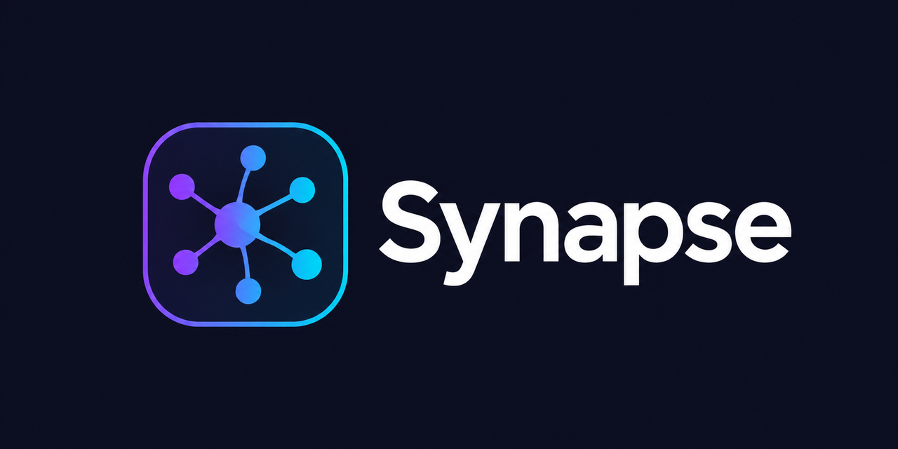

# Synapse

<p align="center"></p>

A native, brain-like second brain: an outliner with linked pages, temporally chained journals,
semantic search, AI assistance and a self-hostable sync server. Runs natively on Android,
Linux and Windows (Rust core + Flutter UI, no webviews).

## Quick start

```bash
cargo test --workspace
cd app && flutter run -d linux
```

See [docs/](docs/README.md) for the plan and architecture.
